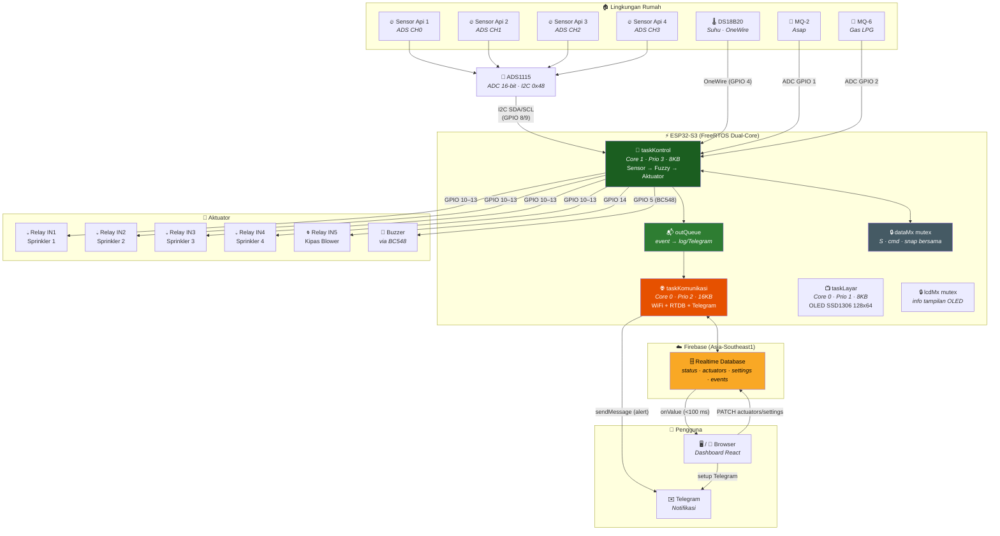
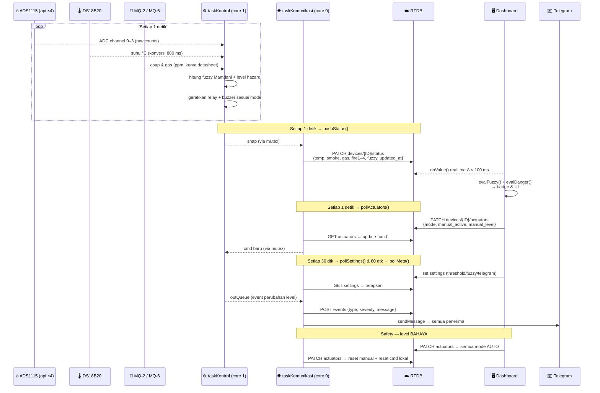
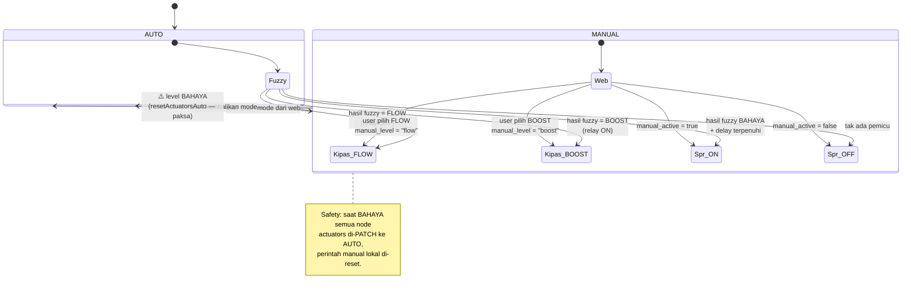

<div align="center">

# 🔥 Sistem Prototype Kebakaran Rumah

**Sistem Pemantau & Pemadam Kebakaran Griya**  
dengan Deteksi Api 4 Titik, Fuzzy Mamdani, dan Notifikasi Telegram Berbasis IoT

<br>

| | |
|---|---|
| **👤 Developer** |  |
| **📡 Perangkat** | ESP32-S3 · FreeRTOS Dual-Core · Multi-Device |
| **🌐 Web** | React + TypeScript + Tailwind · Firebase Hosting |
| **📊 Database** | Firebase Realtime Database *(region Asia-Southeast1)* |
| **📅 Tahun** | 2026 |

<br>

[](https://www.espressif.com/)
[](https://www.freertos.org/)
[](https://react.dev/)
[](https://firebase.google.com/)
[](https://github.com/fahrizapro/sistem-prototype-kebakaran-rumah/commits/main)

**🔗 Demo Live:** https://monitoringkebakaranrumah.web.app

</div>

---

## 📋 Daftar Isi

- [✨ Fitur](#-fitur)
- [🏗️ Arsitektur Sistem](#️-arsitektur-sistem)
- [🔌 Perangkat Keras](#-perangkat-keras)
- [📡 Alur Data](#-alur-data)
- [🗄️ Struktur Database](#️-struktur-database)
- [📁 Struktur Proyek](#-struktur-proyek)
- [💻 Perangkat Lunak](#-perangkat-lunak)
- [🚀 Cara Pakai](#-cara-pakai)
- [⚙️ Logika Kontrol](#️-logika-kontrol)
- [🧯 Troubleshooting](#-troubleshooting)
- [📄 Catatan Lisensi](#-catatan-lisensi)

---

## ✨ Fitur

### Dashboard Web

| # | Fitur | Detail |
|---|-------|--------|
| 1 | 🌡️ **Monitoring Realtime** | Suhu (DS18B20, 1 desimal), asap MQ-2 (ppm), gas MQ-6 (ppm), deteksi api di **4 titik ruangan** |
| 2 | 🚦 **Status Otomatis** | Badge **AMAN / WASPADA / BAHAYA** — dihitung identik di web & firmware, lengkap dengan alasan (reason) |
| 3 | 🎛️ **Kontrol Aktuator** | 4 sprinkler (Auto / Manual ON / Manual OFF) + kipas blower (Auto / Manual **FLOW** / Manual **BOOST**) |
| 4 | 🟢 **Indikator Online/Offline** | Deteksi *heartbeat* per device dari aliran `updated_at` (ambang 15 detik) + keterangan "update N dtk lalu" |
| 5 | 📊 **Grafik Fuzzy** | Visualisasi himpunan keanggotaan Mamdani (suhu/asap/gas) di modal **Informasi** — tanpa label bertumpuk |
| 6 | 📜 **Log Kejadian** | Riwayat event per device dengan severity (info/warning/danger) & timestamp |
| 7 | 📱 **Notifikasi Telegram** | Konfigurasi bot token + hingga beberapa penerima langsung dari web, tombol **Kirim Uji** |
| 8 | 🏠 **Multi-Device** | Manajemen device dinamis (tambah/hapus/ganti nama) — semua ESP32 memakai firmware yang sama, hanya beda `DEVICE_ID` |
| 9 | ⚙️ **Pengaturan Terpandu** | Slider ambang sensor & parameter fuzzy dengan hint singkat (mobile-friendly, tidak overflow) |
| 10 | 🌓 **Dark Mode UI** | Tailwind tokens, responsif Android & desktop |

### Firmware ESP32-S3 (FreeRTOS Dual-Core)

| # | Fitur | Detail |
|---|-------|--------|
| 1 | 🧵 **3 Task FreeRTOS** | `taskKontrol` (core 1/APP — sensor + fuzzy + aktuator), `taskKomunikasi` (core 0/PRO — WiFi + RTDB + Telegram), `taskLayar` (core 0, prioritas 1 — OLED SSD1306), sinkronisasi via mutex + antrean |
| 2 | 🔥 **Deteksi Api 4 Titik** | Sensor api analog via **ADS1115** 16-bit (±4.096V, 250 SPS) — channel 0–3 |
| 3 | 🧮 **Fuzzy Mamdani** | 3 input × 3 himpunan × 27 rule, MIN–MAX, defuzzifikasi diskrit → kipas FLOW/BOOST — **identik dengan `evalFuzzy()` web** |
| 4 | ⏱️ **Trigger Keras Api & Gas** | Api di titik i → sprinkler i & kipas BOOST **langsung aktif**; gas ≥ threshold → kipas BOOST **langsung** (tanpa delay); slider delay hanya jalur fuzzy asap; bertahan `fan_duration` setelah pemicu hilang |
| 5 | 🎚️ **Auto-Baseline Sensor Api** | Threshold otomatis dari udara bersih saat boot (`FIRE_THRESHOLD_AUTO`), margin ±2000 counts |
| 6 | 🧪 **Kalibrasi MQ Otomatis** | Kurva datasheet LPG + auto-R0 saat boot (timeout 90 dtk, fallback R0 = 10 kΩ) |
| 7 | 🔔 **Buzzer Denyut** | Buzzer berdenyut 500 ms on/off saat BAHAYA (driver BC548, active-HIGH) |
| 8 | ✉️ **Telegram** | Alert perubahan level ke semua penerima (HTML), kirim pertama tanpa cooldown, cooldown 10 dtk |
| 9 | 🛡️ **Safety Auto-Switch** | Saat **BAHAYA**, semua aktuator mode manual dipaksa kembali ke **AUTO** (PATCH RTDB + reset perintah lokal) — manual tidak boleh memblokir pemadam |
| 10 | 💓 **Heartbeat 1 Detik** | Status dikirim tiap 1 dtk → web menandai device Online/Offline |
| 11 | 📺 **Layar OLED SSD1306 128x64** | Animasi koneksi WiFi → splash "Sistem Prototype Kebakaran Rumah" + IP (3 dtk) → layar utama 2 baris: **"Rumah A Aman"** / **BAHAYA** + jenis & letak ("API TITIK 2") dengan animasi api berkedip / asap naik; nama ikut meta RTDB; bus I2C kedua (SDA 6, SCL 7) |

---

## 🏗️ Arsitektur Sistem



> Diagram di atas disederhanakan; 4 sensor api semua berasal dari satu ADS1115. Versi interaktif & wiring penuh per luasnya ada di [Perangkat Keras](#-perangkat-keras) & [Alur Data](#-alur-data).

---

## 🔌 Perangkat Keras

### 🧩 Komponen Utama

| # | Komponen | Fungsi | Koneksi |
|---|----------|--------|---------|
| 1 | **ESP32-S3 DevKit** | Mikrokontroler utama (WiFi BLE, dual-core, FreeRTOS) | — |
| 2 | **ADS1115 (16-bit ADC)** | Pembacaan 4 sensor api analog dengan presisi | I2C (SDA=8, SCL=9, ADDR→GND = 0x48) |
| 3 | **Sensor Api @ 4 titik** | Deteksi api per ruangan (keluaran analog) | ADS CH0–CH3 |
| 4 | **DS18B20** | Suhu ruangan digital (bus OneWire, resolusi 12-bit) | GPIO 4 (pull-up 4,7 kΩ ke 3,3V) |
| 5 | **MQ-2** | Deteksi asap (kurva LPG datasheet) | GPIO 1 (ADC1_CH0) via divider 10k/10k |
| 6 | **MQ-6** | Deteksi gas LPG | GPIO 2 (ADC1_CH1) via divider 10k/10k |
| 7 | **Relay 5-Channel 5V** | Penggerak sprinkler 1–4 + kipas blower | GPIO 10–14 (IN1–IN5) |
| 8 | **Buzzer + Transistor BC548** | Alarm denyut saat BAHAYA | GPIO 5 (buzzer aktif-HIGH) |
| 9 | **Catu Daya 5V** | ESP32, relay, modul MQ (heater) | — |

### 📊 Tabel Pin Lengkap (ESP32-S3)

| Fungsi | GPIO | Jenis | Catatan |
|--------|------|-------|---------|
| 🖥️ I2C SDA (ADS1115) | **GPIO 8** | I2C Data | pin default S3 |
| 🖥️ I2C SCL (ADS1115) | **GPIO 9** | I2C Clock | ADDR→GND → addr 0x48 |
| 🔥 Sensor Api 1–4 | **ADS CH0–CH3** | Analog (±4.096V) | via ADS1115, 250 SPS |
| 🌡️ DS18B20 DATA | **GPIO 4** | OneWire | pull-up 4.7 kΩ ke 3.3V |
| 🔔 Buzzer | **GPIO 5** | Digital Output | driver BC548, **aktif-HIGH** |
| 💨 MQ-2 AO | **GPIO 1** | ADC1_CH0 | hasil dibagi 10k/10k → ×2 |
| 🧪 MQ-6 AO | **GPIO 2** | ADC1_CH1 | hasil dibagi 10k/10k → ×2 |
| 💧 Relay Sprinkler 1 | **GPIO 10** | Digital Output | relay IN1 |
| 💧 Relay Sprinkler 2 | **GPIO 11** | Digital Output | relay IN2 |
| 💧 Relay Sprinkler 3 | **GPIO 12** | Digital Output | relay IN3 |
| 💧 Relay Sprinkler 4 | **GPIO 13** | Digital Output | relay IN4 |
| 🌀 Relay Kipas (fan1) | **GPIO 14** | Digital Output | relay IN5 |
| 📺 OLED SDA (SSD1306) | **GPIO 8** | I2C Data (Wire) | satu bus dengan ADS1115 — alamat beda (0x3C vs 0x48) |
| 📺 OLED SCL (SSD1306) | **GPIO 9** | I2C Clock (Wire) | akses dibagi mutex `i2cMx` antar FreeRTOS task |

### ⚡ Logika Output

| Perangkat | Pin | Logika | ON | OFF |
|-----------|-----|--------|----|-----|
| 💧 Relay sprinkler 1–4 | 10–13 | **Active-LOW** | `LOW` (0V) | `HIGH` (3.3V) |
| 🌀 Relay kipas | 14 | **Active-LOW** | `LOW` (0V) | `HIGH` (3.3V) |
| 🔔 Buzzer (BC548) | 5 | **Active-HIGH** | `HIGH` (3.3V) | `LOW` (0V) |

> Modul relay umum dilengkapi optocoupler dengan logika aktif-LOW (IN = GND → relay ON). Di firmware ini diatur dengan `RELAY_ACTIVE_LOW 1`. Kipas **hanya ON saat BOOST** — saat FLOW relay tetap OFF.

---

## 📡 Alur Data



### 🧭 Diagram State Mode Aktuator



### 💓 Deteksi Online/Offline (Heartbeat)

| Kondisi | Yang Terjadi |
|---------|-------------|
| ESP32 hidup & WiFi OK | `updated_at` berubah tiap detik → 🟢 **Online** |
| Offline / listrik mati | tidak ada paket baru → setelah **15 dtk** 🔴 **Offline** |
| Sensor rusak (nilai stuck) | `updated_at` tetap berubah → tetap 🟢 Online (device hidup, sensor bermasalah) |

> Web membandingkan **nilai string `updated_at`** antar snapshot — bukan nilai sensor — sehingga deteksi tidak terpengaruh data sensor yang stabil, dan re-render "umur data" tiap 5 detik.

---

## 🗄️ Struktur Database

Realtime Database (region `asia-southeast1`) — JSON tree:

```
fireguard-ff7c1-default-rtdb/
├── settings/                     # pengaturan global (web → firmware)
│   ├── temp_threshold: 50
│   ├── smoke_threshold: 1000
│   ├── gas_threshold: 2000
│   ├── sprinkler_delay: 3        # detik, jeda jalur fuzzy (api keras → langsung)
│   ├── fan_delay: 2              # detik, jeda jalur fuzzy (api keras → langsung)
│   ├── fan_duration: 30          # detik, durasi BOOST setelah pemicu hilang
│   ├── fuzzy_temp_aman / fuzzy_temp_bahaya: 35 / 55
│   ├── fuzzy_smoke_rendah / fuzzy_smoke_tinggi: 400 / 600
│   ├── fuzzy_gas_rendah / fuzzy_gas_tinggi: 500 / 2000
│   ├── fuzzy_fan_flow: 50
│   └── telegram/
│       ├── enabled: true
│       ├── bot_token: "..."      # token bot (tidak tampil di UI web)
│       └── recipients/           # chatId → {label}
│
├── devices/
│   ├── ESP32-A/
│   │   ├── meta/name: "Rumah A"
│   │   ├── status/               # firmware → web (PATCH tiap 1 dtk)
│   │   │   ├── temperature: 28.3
│   │   │   ├── smoke_mq2: 0
│   │   │   ├── gas_mq6: 0
│   │   │   ├── fire1 .. fire4: false
│   │   │   ├── fuzzy_fan: "flow"
│   │   │   ├── fuzzy_sprinkler: false
│   │   │   └── updated_at: "2026-11-02T…"
│   │   └── actuators/            # web ⇄ firmware (poll tiap 1 dtk)
│   │       ├── sprinkler1..4 { mode: "auto"|"manual", manual_active: bool }
│   │       └── fan1        { mode, manual_active, manual_level: "flow"|"boost" }
│   └── ESP32-B/ …
│
└── events/                       # log kejadian (POST dari firmware)
    └── {device_id, device_name, event_type,
         severity: "info"|"warning"|"danger", message, created_at}
```

> 🛡️ Rules DB saat ini **terbuka** (mode demo/tugas). Panduan pengunciannya ada di `docs/FIREBASE_SETUP.md` dan README firmware.

---

## 📁 Struktur Proyek

```
📂 sistem-prototype-kebakaran-rumah/
├── 📄 README.md                     # Dokumentasi ini
├── 📄 firebase.json                 # Config Hosting (situs: monitoringkebakaranrumah)
├── 📄 .firebaserc                   # Aliases target hosting
├── 📄 database.rules.json           # Rules RTDB (terbuka — mode demo)
│
├── 📂 docs/
│   ├── 📄 FIREBASE_SETUP.md         # Panduan setup project Firebase
│   └── 📂 legacy/                   # Arsip (tidak dipakai runtime)
│       ├── 📂 supabase/             # Skema database versi lama (pra-Firebase)
│       └── 📂 bolt-scaffold/        # Sisa template generator awal
│
├── 📂 src/                          # Dashboard web
│   ├── 📄 App.tsx                   # Entry: device selection, tracking online/offline
│   ├── 📄 main.tsx                  # Bootstrap React
│   ├── 📂 components/
│   │   ├── 📄 HousePanel.tsx        # Dashboard per device (header + badge online)
│   │   ├── 📄 SensorCard.tsx        # Kartu sensor (suhu 1 desimal, asap, gas)
│   │   ├── 📄 SprinklerControl.tsx  # Kontrol sprinkler 1–4 (auto/manual)
│   │   ├── 📄 FanControl.tsx        # Kontrol kipas (AUTO / FLOW / BOOST)
│   │   ├── 📄 SettingsModal.tsx     # Slider pengaturan + hint
│   │   ├── 📄 TelegramModal.tsx     # Config bot & penerima + kirim uji
│   │   ├── 📄 InfoModal.tsx         # Grafik keanggotaan fuzzy
│   │   ├── 📄 EventLogModal.tsx     # Log kejadian
│   │   ├── 📄 DeviceManagerModal.tsx# Tambah/hapus/rename device
│   │   ├── 📄 icons.tsx             # Ikon SVG custom (3D flame, dsb.)
│   │   └── 📄 SetupScreen.tsx       # Layar panduan saat .env kosong
│   └── 📂 lib/
│       ├── 📄 firebase.ts           # Init Firebase dari .env
│       ├── 📄 db.ts                 # evalFuzzy, evalDanger, helpers RTDB
│       └── 📄 telegram.ts           # Kirim pesan uji Telegram
│
├── 📂 firmware/
│   ├── 📄 README.md                 # Wiring, kalibrasi, troubleshooting firmware
│   └── 📂 fireguard_esp32/
│       └── 📄 fireguard_esp32.ino   # Firmware utama ESP32-S3 (FreeRTOS dual-core)
│
└── 📄 (file tooling di root: package.json, vite.config.ts, tsconfig*, eslint, tailwind, postcss, index.html)
```

### 📄 Deskripsi File

| File | Bahasa | Baris | Fungsi |
|------|--------|-------|--------|
| `firmware/fireguard_esp32.ino` | C++ (Arduino) | ~850 | Firmware ESP32-S3: sensor, fuzzy, aktuator, RTDB, Telegram |
| `src/App.tsx` | TypeScript+TSX | 670 | entry web: pemilihan device, tracking online, routing modals |
| `src/lib/db.ts` | TypeScript | 507 | fuzzy & hazard calc, kontrak RTDB, listeners realtime |
| `src/components/TelegramModal.tsx` | TSX | 349 | konfigurasi Telegram & kirim uji |
| `src/components/SettingsModal.tsx` | TSX | 339 | slider pengaturan threshold & fuzzy |
| `src/components/HousePanel.tsx` | TSX | 268 | dashboard per-device + status online |
| `src/components/InfoModal.tsx` | TSX | 231 | grafik keanggotaan fuzzy Mamdani |
| `src/components/FanControl.tsx` | TSX | 134 | card kipas AUTO/FLOW/BOOST |
| `src/components/SprinklerControl.tsx` | TSX | 115 | card sprinkler 1–4 |
| `src/lib/telegram.ts` | TypeScript | 120 | kirim pesan uji via Telegram Bot API |

---

## 💻 Perangkat Lunak

### 🛠️ Tools

| Tool | Fungsi |
|------|--------|
| [Arduino IDE 2.x](https://www.arduino.cc/en/software) | Kompilasi & upload firmware |
| [ESP32 Board Package](https://github.com/espressif/arduino-esp32) (3.x) | Board support ESP32-S3 |
| [Node.js ≥ 18 + npm](https://nodejs.org/) | Build dashboard web |
| [Firebase CLI](https://firebase.google.com/docs/cli) | Deploy hosting & rules |

### 📚 Library Firmware (Library Manager)

| Library | Fungsi |
|---------|--------|
| [ArduinoJson 7.x](https://arduinojson.org/) | Parsing & serialisasi JSON untuk RTDB |
| [Adafruit ADS1X15](https://github.com/adafruit/Adafruit_ADS1X15) | Driver ADS1115 (sensor api ×4) |
| [OneWire + DallasTemperature](https://github.com/milesburton/Arduino-Temperature-Control-Library) | DS18B20 |
| HTTPClient (bawaan core) | PATCH/GET/POST ke RTDB + Telegram Bot API (TLS `setInsecure`, keep-alive) |
| FreeRTOS (bawaan core) | 2 task pinned-to-core, antree, mutex |

### 🌐 Stack Web

| Library | Versi | Fungsi |
|---------|-------|--------|
| [React](https://react.dev/) | 18.x | UI framework |
| [Vite](https://vitejs.dev/) | 7.x | Build tool + dev server |
| [TypeScript](https://www.typescript.org/) | 5.x | Type safety |
| [Tailwind CSS](https://tailwindcss.com/) | 3.x | Styling (dark theme tokens) |
| [firebase-js-sdk](https://firebase.google.com/docs/web/setup) | 11.x | Realtime listeners (`onValue`) + REST helpers |

---

## 🚀 Cara Pakai

### ✅ Prasyarat

- Node.js ≥ 18, npm
- Firebase project + Realtime Database aktif (panduan: [docs/FIREBASE_SETUP.md](docs/FIREBASE_SETUP.md))
- Arduino IDE 2.x + board ESP32-S3 (+ kabel data)

### 🌐 Menjalankan Dashboard Web

```bash
# 1. Clone repositori
git clone https://github.com/fahrizapro/sistem-prototype-kebakaran-rumah.git
cd sistem-prototype-kebakaran-rumah

# 2. Install dependencies
npm install

# 3. Salin .env.example → .env lalu isi config dari Firebase Console
cp .env.example .env

# 4. Development server
npm run dev      # http://localhost:5173

# 5. Build + deploy ke Firebase Hosting
npm run deploy   # → https://monitoringkebakaranrumah.web.app
```

### ⚡ Menyiapkan Firmware ESP32

**1. Konfigurasi wajib** — edit bagian atas `firmware/fireguard_esp32/fireguard_esp32.ino`:

```cpp
#define DEVICE_ID        "ESP32-A"     // ← bedakan di tiap perangkat (ESP32-B, …)
#define WIFI_SSID        "NamaWiFi"    // ← nama hotspot/router (2.4 GHz)
#define WIFI_PASSWORD    "..."         // ← password
#define FIREBASE_DB_URL  "https://xxx-default-rtdb.asia-southeast1.firebasedatabase.app"
```

**2. Library**: install `ArduinoJson`, `Adafruit ADS1X15`, `OneWire`, `DallasTemperature` via Library Manager.

**3. Wiring**: ikuti [tabel pin](#-tabel-pin-lengkap-esp32-s3) di atas (detail lengkap + diagram ada di `firmware/README.md`).

**4. Upload**: Board = **ESP32S3 Dev Module** → pilih Port → **Upload**.

**5. Verifikasi** via Serial Monitor **115200**:

```
=== Sistem Prototype Kebakaran Rumah (FreeRTOS) | ESP32-A ===
[ADS] ADS1115 siap…
[WiFi] Terhubung…
[KOM] Pengaturan diperbarui dari web
Task Kontrol & Komunikasi berjalan ✔
```

**6. Uji end-to-end**: buka dashboard → device Online → nilai sensor bergerak → coba kontrol sprinkler/kipas → uji tombol **Kirim Uji** Telegram.

> ⚠️ Sensor MQ butuh **warm-up** beberapa menit saat pertama. Kalibrasi `R0` otomatis berjalan 90 detik sejak boot di udara bersih — nilai optimal tampak di Serial `[CAL] MQ2 R0 = …`. Sensor api meng-*baseline* otomatis saat boot: pastikan **udara bersih** saat menyalakan perangkat.

---

## ⚙️ Logika Kontrol

### 🚦 Level Hazard (`evalLevel` firmware = `evalDanger` web)

| Level | Kondisi (salah satu) | Respons |
|-------|----------------------|---------|
| 🟢 **AMAN** (0) | semua di bawah ambang | kipas FLOW (idle), sprinkler OFF |
| 🟡 **WASPADA** (1) | suhu ≥ **0.75 ×** ambang, asap ≥ **0.5 ×** ambang, gas ≥ **0.5 ×** ambang | kipas mengikuti fuzzy, buzzer beep kilat |
| 🔴 **BAHAYA** (2) | api terdeteksi di titik mana pun, suhu ≥ ambang, asap ≥ ambang, gas ≥ ambang | sprinkler titik terkait **langsung ON**, kipas **BOOST langsung**, buzzer denyut, Telegram + event log, **aktuator manual dipaksa AUTO** |

### 🎯 Ambang Default

| Parameter | Nilai | Dipakai |
|-----------|-------|---------|
| 🌡️ Suhu BAHAYA | **50 °C** | trigger keras + WASPADA pada 37.5 °C |
| 💨 Asap BAHAYA (MQ-2) | **1000 ppm** | trigger keras + WASPADA pada 500 ppm |
| 🧪 Gas BAHAYA (MQ-6) | **2000 ppm** | trigger keras + WASPADA pada 1000 ppm |
| ⏱️ Delay sprinkler | **3 s** (per titik) | hanya jalur fuzzy (asap/gas); api keras → **langsung ON** |
| ⏱️ Delay kipas | **2 s** | hanya jalur fuzzy asap; api/gas keras → **BOOST langsung** |
| ⏱️ Durasi kipas | **30 s** | durasi BOOST setelah pemicu hilang |

### 🧮 Fuzzy Mamdani (kipas)

- **Input**: suhu (aman 35 °C / bahaya 55 °C), asap (rendah 400 / tinggi 600 ppm), gas (rendah 500 / tinggi 2000 ppm)
- **Himpunan**: 3 per input (aman–waspada–bahaya / rendah–sedang–tinggi) dengan overlap ¼ rentang
- **Rule**: 3 × 3 × 3 = **27 rule** (MIN agregasi antar-input, MAX antar-rule)
- **Output**: defuzzifikasi diskrit → **OFF / FLOW (relay off) / BOOST (relay on)**, bobot `fuzzy_fan_flow = 50`

### 🛡️ Aturan Mode Manual

| Mode | Perilaku | Relay |
|------|----------|-------|
| Sprinkler **Auto** | ikut trigger api + fuzzy, dengan delay | IN yang terkait |
| Sprinkler **Manual-ON** | ON terus (`manual_active = true`) | IN ON |
| Sprinkler **Manual-OFF** | OFF — **kecuali** BAHAYA (lihat bawah) | IN OFF |
| Kipas **Auto** | ikut fuzzy: FLOW (relay off) / BOOST (relay on) | IN sesuai pwm |
| Kipas **FLOW** | manual pelan | IN OFF |
| Kipas **BOOST** | manual kencang | IN ON |

> 🛡️ **Safety auto-switch:** saat level masuk **BAHAYA**, firmware mem-patch semua node `actuators` ke `mode:auto` & `manual_active:false` dan mereset perintah lokal (`resetActuatorsAuto()`). Dengan itu mode manual **tidak bisa memblokir** pemadam — semua aktuator merespons api/fuzzy lagi, dan setting manual harus di-set ulang setelah kondisi aman.

---

## 🧯 Troubleshooting

| Gejala | Kemungkinan penyebab | Solusi |
|--------|---------------------|--------|
| Device **Offline** di web | WiFi 2.4 GHz / listrik / kredensial | cek hotspot + SSID/password, lihat log `[WiFi]` Serial |
| Suhu **0°C** / `-127` | wiring DS18B20 terbalik, pull-up lemah | cek polaritas + pull-up 4.7 kΩ, re-scan jalan tiap 5 dtk |
| Relai tidak klik | logika relay beda modul | sesuaikan `RELAY_ACTIVE_LOW (0/1)` |
| Buzzer tidak bunyi | transistor / logika aktif salah | `BUZZER_ACTIVE_HIGH 1` + driver BC548 (bukan buzzer pasif ke GPIO) |
| Asap/gas selalu 0 | divider AO atau MQ belum panas | tunggu ±2 mnt warm-up, cek rangkaian divider 10k/10k |
| Kalibrasi MQ gagal | R0 tak terbaca saat boot | catat `[CAL] MQ2 R0 = …` lalu hard-code → `MQ2_R0` |
| Telegram tidak masuk | token/cal chat-id salah | cek log `[TG] GAGAL … HTTP <code>`, kirim uji dari web |

Dokumentasi lebih dalam (wiring penuh, kalibrasi FIRE/MQ, log `[DBG]/[CAL]/[DS]/[TG]`) → **[firmware/README.md](firmware/README.md)**.

---

## 📄 Catatan Lisensi

© 2026 — **Sistem Prototype Kebakaran Rumah**  
Proyek demo / tugas pembelajaran IoT — bebas dipakai dengan tetap mencantumkan atribusi.

> 🔥 Live: https://monitoringkebakaranrumah.web.app · 🛠️ Repo: [fahrizapro/sistem-prototype-kebakaran-rumah](https://github.com/fahrizapro/sistem-prototype-kebakaran-rumah)

</div>
